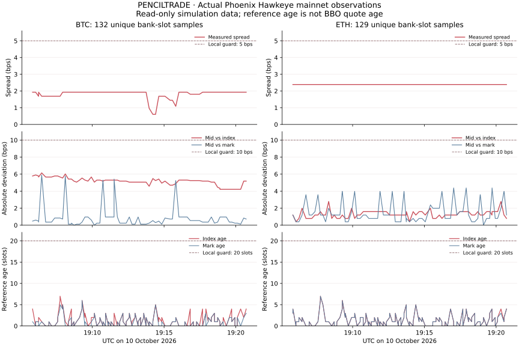

# Review Phoenix BBO measurements

This report uses real public Phoenix mainnet data. It excludes synthetic stub prices. BBO means best bid and offer. The primary BBO measurements use unsigned, read-only Hawkeye simulations. The collection used no trades, signatures, credentials, or purchases.

This report preserves historical BBO research and candidate midpoint guards. V2 fills and liquidations use the guarded mark. Book spread and side-presence flags do not gate v2 execution. These candidate tables do not report current program guard results. The Oracle chapter describes the current implementation.

## Reproduce the collection

The primary window runs from 2026-10-10T19:05:45.160Z to 2026-10-10T19:20:43.615Z UTC. Collection complete is True. The collector made 292 attempts and retained 261 valid unique market/slot observations. It recorded 0 invalid observations and removed 31 duplicate-slot observations. The nominal interval is 5000 ms. The summary records actual cadence.

Each simulation returns BBO, mark, index, and reference update slots from the same bank state. An oracle supplies external price data. The mark is the oracle's reference trading price. A slot is a scheduled Solana block opportunity. BTC and ETH simulations use separate requests. Slot timestamps do not timestamp quotes.

Percentiles and rejection rates give each observation equal weight. They do not estimate availability over continuous time. A percentile marks a stated fraction of sampled values.

1. On the collection host, install the project's `@solana/web3.js` dependency.
2. From the repository root, use one collection command below.
3. After collection, run `python3 research/analyze-phoenix.py` to regenerate the report, JSON, and CSV files.

| Command | Collection |
| --- | --- |
| `node scripts/collect-phoenix.mjs` | Public REST data. |
| `PHOENIX_COLLECTION_MODE=hawkeye PHOENIX_SAMPLE_INTERVAL_MS=5000 node scripts/collect-phoenix.mjs` | Read-only RPC simulations. The environment variables select Hawkeye and the interval. |

## Compare quotes and references

A basis point, or bp, equals 0.01%. The tables use bps for basis points. The midpoint is halfway between best bid and ask. Spread is the gap between those quotes. L2 records orderbook prices and available sizes.

| Market | Valid samples | Spread p50 / p95 / max (bps) | Absolute mid-index p50 / p95 / max (bps) | Absolute mid-mark p50 / p95 / max (bps) | Maximum index / mark age (slots) |
|---|---:|---|---|---|---|
| BTC | 132 | 1.926 / 1.926 / 1.926 | 5.179 / 5.781 / 6.143 | 0.542 / 2.887 / 5.902 | 7 / 6 |
| ETH | 129 | 2.387 / 2.388 / 2.388 | 1.194 / 1.830 / 2.786 | 1.194 / 3.980 / 4.379 | 7 / 7 |

Unchanged quotes at different bank slots remain valid observations. The analysis removes repeated reads of the same market/slot. `phoenix-hawkeye/raw.ndjson` preserves raw return bytes and simulation logs.

## Compare candidate guards

A sample passes the candidate guards when all these conditions hold:

- Both quotes exist, and bid < ask.
- Spread stays within the stated bound.
- Midpoint deviation from both mark and index stays within the stated bound.
- Both reference update slots are at most 20 slots old.

The percentages exclude failed or invalid simulations.

| Maximum spread (bps) | Maximum deviation from both references (bps) | BTC accepted | ETH accepted |
|---:|---:|---:|---:|
| 2 | 5 | 17.42% | 0.00% |
| 2 | 10 | 100.00% | 0.00% |
| 2 | 15 | 100.00% | 0.00% |
| 2 | 25 | 100.00% | 0.00% |
| 5 | 5 | 17.42% | 100.00% |
| 5 | 10 | 100.00% | 100.00% |
| 5 | 15 | 100.00% | 100.00% |
| 5 | 25 | 100.00% | 100.00% |
| 10 | 5 | 17.42% | 100.00% |
| 10 | 10 | 100.00% | 100.00% |
| 10 | 15 | 100.00% | 100.00% |
| 10 | 25 | 100.00% | 100.00% |

The historical candidate used a 5 bp spread limit, 10 bp reference deviation, and 20-slot reference age. These are not v2 defaults. V2 devnet bootstrap uses a 50 bp mark-to-index deviation and 20-slot age. The tables do not calculate availability under that policy.

Guard thresholds bound accepted price differences. They do not bound profit from unrestricted synthetic exposure, establish quote age, or establish a minimum attack cost.

## Estimate conditional sweeps

The REST request used `includeSplines=true` to obtain the effective book. The tested `include_splines=true` spelling omitted spline data. `include-splines-param-evidence.json` preserves paired raw responses. The camelCase spelling matches the official Rise SDK and returned active splines. Splines supply additional reported liquidity.

For each measured book, the scenario holds the opposite best quote fixed. It consumes one side until the next best quote shifts the midpoint by 5 bps. It then sums gross executed notional. Notional is the trade's total price exposure. These calculations use actual levels but do not execute an attack.

The results do not represent irrecoverable USDC cost or guaranteed quotes. Makers can cancel, risk rules can remove liquidity, and attackers can own some levels.

| Market | L2 samples | Best bid / ask notional median (USD) | Gross buy sweep for +5 bps midpoint p50 / p95 (USD) | Gross sell sweep for −5 bps midpoint p50 / p95 (USD) |
|---|---:|---|---|---|
| BTC | 72 | 5,881 / 5,882 | 846,240 / 846,325 | 842,027 / 842,099 |
| ETH | 72 | 5,203 / 5,204 | 134,397 / 134,435 | 204,171 / 204,230 |

The effective-L2 window runs from 2026-10-10T19:11:15.517Z to 2026-10-10T19:23:16.549Z UTC. Its nominal interval is 10000 ms. JSON preserves status counts. This window differs from the Hawkeye window. The analysis does not combine them into an atomic sample. An atomic sample observes all fields in one state.

With the opposite quote fixed, spread widens by approximately twice the target midpoint shift. A +5 bps sweep therefore adds roughly 10 bps of spread. The 5 bps guard rejects it unless other quotes also change. These notionals do not estimate the cheapest attack that passes the guards.

A cheaper competing mechanism places a quote inside the spread without consuming the book. It can move the midpoint by approximately half the current spread. At a 2 bps spread, this permits approximately a 1 bps single-observation shift. At 200×, that equals 2% of margin before the haircut. Collateral, fill risk, and fees still apply. Near bust, the abrupt full-margin loss matters more than smooth PnL changes.

PnL means profit or loss. The complete 1/5/10/25 bps scenarios appear in `l2-depth-scenarios.csv`. The website separates measured summaries from local mock scenarios.

## Interpret historical mark/index data

The historical API request covers 24 hours with one-minute aggregation. The API returned sparse rows. The analysis does not fill missing minutes. These rows measure the difference between mark and index. They do not measure historical BBO or its rejection rates.

| Market | Returned rows | Absolute mark-index p50 / p95 / max (bps) | Rows above 10 bps |
|---|---:|---|---:|
| BTC | 943 | 6.047 / 7.527 / 12.958 | 1.59% |
| ETH | 939 | 1.201 / 2.460 / 3.636 | 0.00% |

BTC's difference exceeded 10 bps in some rows. Those rows do not establish the cause or BBO at those times. A wider deviation bound can improve availability while permitting larger distortions.

1. Before retaining these parameters for devnet, collect a longer BBO sample.
2. Compare 10 vs 15 bps bounds.
3. Include stressed periods in that comparison.

## Interpret the result

Hawkeye returns BBO, mark, index, and reference slots from the same state. V2 authenticates the configured executable and account list. It enforces return magic/version, mark/index ages, mark-slot monotonicity, and mark-to-index deviation. It does not require BBO side presence or enforce spread.

The sample supports measurements of spread and reported depth. Raw BBO still permits small changes from quotes inside the spread. Phoenix uses a composite mark for valuation and liquidation. Its components include adjusted oracle, book, and external perpetual prices. The mark/index comparison shares venue dependencies. An independent aggregate oracle can add an independent constraint.

The current experiment uses the guarded mark and an admission slot window for fills. An invalid mark/index guard defers the head until a valid observation or expiry. An invalid book alone does not defer execution. These measurements do not prove manipulation resistance or the absence of oracle-lag arbitrage. Oracle-lag arbitrage exploits delayed price updates.

## Integrate Hawkeye

The program is `RiSeVw3ZjNfsaXPRb4mgaqYaEEt41pNNJoDvVh7pgQj`. Its instruction uses the first 8 SHA-256 bytes of `global:view_bbo`. The view reads these accounts:

- The Phoenix program and global configuration.
- Global trader index pages and active trader buffer pages.
- The perp asset map and market orderbook.
- The spline collection.

The return contains 64 bytes with magic hex `7141a71fa31fcaef` and version 1. The magic value identifies the return format.

| Offset | Type | Field |
| --- | --- | --- |
| 8 | u16 | Version. |
| 10 | u8 | Flags. |
| 16 | u64 | Bid. |
| 24 | u64 | Ask. |
| 32 | u64 | Mark. |
| 40 | u64 | Index. |
| 48 | u64 | Mark update slot. |
| 56 | u64 | Index update slot. |

Absence flags describe book sides. V2 does not require those flags for mark execution.

The conversion is USD = ticks × tickSize × 10^baseLotsDecimals / 1,000,000. Current BTC metadata gives USD 1 per tick. ETH metadata gives USD 0.1 per tick.

Derive conversion from pinned market metadata.
Do not assume a common decimal scale.

CU means compute units, Solana's measure of execution work.

| Market | Simulation CU median / p95 / max |
|---|---|
| BTC | 263,812 / 278,141 / 282,231 |
| ETH | 200,620 / 277,667 / 282,505 |

These values cover one ComputeBudget instruction and the read-only Hawkeye view. Raw logs separate view CU. The difference is 150 CU. The outer PENCILTRADE program needs additional compute for accounting and token CPIs. A cross-program invocation, or CPI, calls another Solana program. These figures do not benchmark a complete execution transaction.

## Respect measurement limits

- The short weekend window covers neither stress conditions nor security testing.
- Hawkeye BBO contains no quote timestamp or depth. Fresh mark/index slots do not establish quote freshness.
- Phoenix mark/index guards share venue dependencies. They do not provide an independent oracle.
- Acceptance weights valid sampled slots equally. It does not cover every transaction or second.
- RPC elapsed times include this research environment and public transport. They do not measure Phoenix execution or PENCILTRADE fill latency.
- L2 sweeps replay reported levels hypothetically. They do not establish irreversible attacker loss, guaranteed execution, or minimum attack cost. Own-order cancellation and quotes inside the spread can cost less. With the opposite quote fixed, a 5 bps midpoint shift fails a 5 bps spread guard unless other quotes change.
- Historical mark/index rows cannot estimate historical BBO rejection.
- Initial REST polling at 1Hz reached HTTP429. Raw attempts remain available, and effective L2 uses slower polling. Program pricing uses Hawkeye CPI rather than REST.

## Read the sources and data

- [Hawkeye ABI, official Rise Rust source](https://github.com/Ellipsis-Labs/rise-public/blob/master/rust/ix/src/hawkeye.rs)
- [Hawkeye ABI, official Rise TypeScript source](https://github.com/Ellipsis-Labs/rise-public/blob/master/ts/src/hawkeye.ts)
- [Phoenix mark-price design](https://docs.phoenix.trade/phoenix/margin-and-risk/mark-price)
- [Phoenix public orderbook API](https://docs.phoenix.trade/api/exchange/get-orderbook)
- [Phoenix REST history API](https://docs.phoenix.trade/api/exchange/get-market-stats-history)
- [Phoenix API rate-limit and streaming guidance](https://docs.phoenix.trade/sdk/ws-api-best-practices)

| File | Contents |
| --- | --- |
| `phoenix-hawkeye/raw.ndjson` | Full simulation responses, slots, return bytes, logs, and request/response timing. |
| `hawkeye-samples.csv` | Normalized BBO samples from the same state. |
| `phoenix-l2-effective/raw.ndjson` | Effective public REST L2 and separate market-stat responses. |
| `l2-depth-scenarios.csv` | Conditional sweeps across observed levels. |
| `history-BTC.json`, `history-ETH.json` | Sparse mark/index history from the requested 24-hour window. |
| `oracle-summary.json` | Website summary with estimator and limitation labels. |
| `phoenix-live/raw.ndjson` | Initial faster polling attempts and HTTP429 responses. |

The figure uses read-only mainnet observations. It excludes devnet stub quotes.
